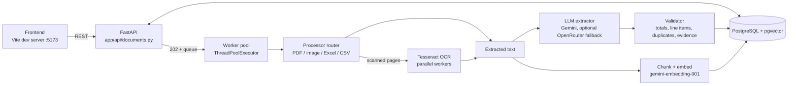
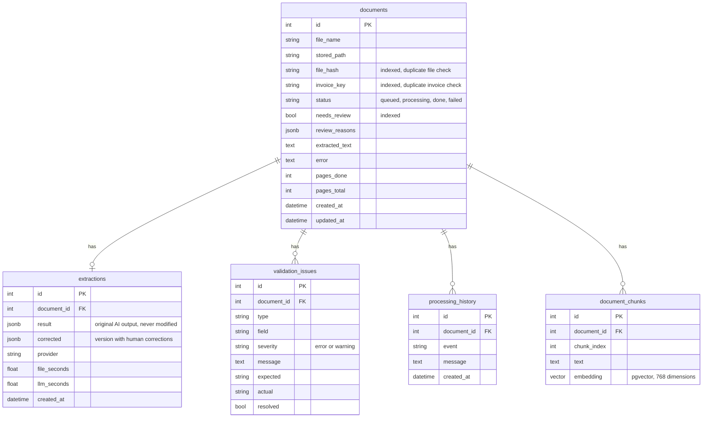

# DocuMind

DocuMind reads invoices from PDFs, scanned images, Excel and CSV files, extracts structured data with an LLM, validates it, and lets a person review and correct the result. Every extracted value carries evidence and a confidence score, and anything doubtful is flagged for human review instead of being passed through silently.

## Features

- **Input formats:** digital PDF, scanned PDF, images (OCR with Tesseract, parallel workers), Excel (`.xlsx`, `.xls`) and CSV
- **Extraction:** Gemini, with an optional OpenRouter fallback; each field returns a value with confidence and evidence
- **Validation:** missing fields, numeric checks, subtotal + tax = total, line items vs. subtotal, duplicate file (hash) and duplicate invoice (key) detection, evidence-not-found warnings
- **Review workflow:** documents that fail a check are marked `needs_review`; a person can correct values, approve, or reprocess
- **Background processing:** uploads return immediately (`202`); a worker pool processes documents and reports page progress
- **Search:** keyword, semantic (pgvector) and hybrid search over document text
- **History:** every document keeps a timeline of processing events
- **Frontend:** upload, list, detail, correction and progress views

## Architecture



Processing flow for one upload:

1. `POST /documents` stores the file, computes its hash, creates a `documents` row with status `queued` and returns `202`.
2. The worker picks it up (`processing`), the router chooses the right processor, OCR runs for scanned pages, and page progress is written to `pages_done` / `pages_total`.
3. The LLM extracts the fields; the validator checks them against each other and against previously processed documents.
4. The result is saved (`done`) with review reasons, or the document is marked `failed` with an error message.
5. The text is chunked and embedded for search.

## Project layout

```
backend/app/
  api/          FastAPI routes
  processors/   pdf, image, excel, csv, OCR, router, invoice splitter
  extraction/   LLM extractor, prompts, schemas
  validation/   invoice validator, duplicate detection
  search/       embeddings, keyword / semantic / hybrid search
  services/     pipeline, background worker, ingest, corrections, progress
  db/           SQLAlchemy models, CRUD, migrations
backend/tests/  119 tests
evaluation/     labelled dataset, run_eval.py, results, REPORT.md
frontend/       web UI
docker-compose.yml   PostgreSQL + pgvector
```

## Database schema



Notes:

- All child tables use `ON DELETE CASCADE`.
- The AI output (`extractions.result`) is stored unchanged. Human corrections go into `extractions.corrected`, so the original is always available for audit and evaluation.
- Embeddings are chunks of 1500 characters with 200 overlap, 768 dimensions (`gemini-embedding-001`).
- `db/migrate.py` adds missing columns to existing tables (idempotent), since `create_all` does not alter existing tables.
- In tests, SQLite is used: `JSONB` falls back to `JSON` and the vector column to JSON text.

## API

| Method | Path | Purpose |
|---|---|---|
| GET | `/health` | health check |
| POST | `/documents` | upload one or more files, returns `202` |
| GET | `/documents` | list, filter by status / review flag / text |
| GET | `/documents/{id}` | detail, status, progress, issues, history |
| GET | `/documents/{id}/result` | extracted result (with corrections applied) |
| PATCH | `/documents/{id}/result` | correct extracted values |
| POST | `/documents/{id}/approve` | approve after review |
| POST | `/documents/{id}/reprocess` | run the pipeline again, returns `202` |
| GET | `/search` | keyword / semantic / hybrid search |

Interactive docs are available at `http://127.0.0.1:8000/docs` while the backend is running.

## Setup

### Prerequisites

- Python 3.10+ and Node.js
- Docker (for PostgreSQL)
- Tesseract OCR installed on the system (for example `sudo apt install tesseract-ocr`)
- A Gemini API key

### 1. Configure `backend/.env`

Do not commit this file.

```
GEMINI_API_KEY=...
DATABASE_URL=postgresql+psycopg://documind:<password>@127.0.0.1:5432/documind
POSTGRES_PASSWORD=<same password as in DATABASE_URL>
```

Optional settings (defaults in `backend/app/config.py`):

| Variable | Default | Meaning |
|---|---|---|
| `GEMINI_MODELS` | `gemini-2.5-flash,gemini-2.5-flash-lite` | models tried in order |
| `OPENROUTER_API_KEY`, `OPENROUTER_MODELS`, `ALLOW_OPENROUTER` | off | fallback provider |
| `MAX_WORKERS` | 2 | documents processed at the same time |
| `OCR_WORKERS` | half of CPU cores | parallel OCR processes |
| `MAX_UPLOAD_MB` | 200 | upload size limit |
| `LLM_TIMEOUT_SECONDS` | 45 | timeout per LLM call |
| `CORS_ORIGINS` | `http://localhost:3000,http://localhost:5173` | allowed origins |
| `EMBED_MODEL`, `EMBED_DIM` | `gemini-embedding-001`, 768 | embeddings |
| `UPLOAD_DIR` | `backend/uploads` | where files are stored |

### 2. Start the database

```bash
cd ~/docuMind
docker compose --env-file backend/.env up -d
```

### 3. Start the backend

```bash
python -m venv .venv && source .venv/bin/activate   # first time only
pip install -r backend/requirements.txt              # first time only
bash backend/start.sh
```

Or manually, from the `backend/` folder:

```bash
uvicorn app.main:app --reload
```

The app module is `app.main`, so `uvicorn main:app` will not work.

### 4. Start the frontend

```bash
cd frontend
npm install     # first time only
npm run dev
```

Open `http://localhost:5173` and upload an invoice.

### Run the tests

```bash
cd backend
python -m pytest -q
```

119 tests pass (the tests use SQLite, no Docker needed).

### Run the evaluation

```bash
cd evaluation
python run_eval.py --sleep 4
```

Results are written to `evaluation/results/results.json`. See `evaluation/REPORT.md` for the full report.

## Evaluation summary

Measured on 34 labelled files (32 valid, 2 deliberately bad), with the real pipeline:

| | Gemini 3.1 | Gemini 3.5 |
|---|---|---|
| Field accuracy | 89.8% | 90.2% |
| Line item accuracy | 89.0% | 89.0% |
| Silent errors (wrong and not flagged) | 0 | 0 |
| False alarms on correct documents | 0 | 0 |
| Mean time per file | 7.9 s | 11.4 s |

Every document with a wrong value was flagged for review. The weak spot is heavily degraded images. Details are in `evaluation/REPORT.md`.

## Design decisions

**Thread pool instead of Redis.** Background work runs in a `ThreadPoolExecutor` (`MAX_WORKERS`, default 2). The job is I/O-bound (LLM calls) and the pool size is deliberately small to stay inside the free Gemini quota, so a thread pool is enough and keeps setup to one database container. Document state lives in PostgreSQL, so nothing is lost on restart: `requeue_unfinished()` puts unfinished documents back in the queue at startup. The trade-off is that the worker runs inside the API process and cannot scale across machines; for that, the same `submit(doc_id)` interface can be moved to a Redis-backed queue.

**Flag, don't guess.** When the system is unsure (missing evidence, totals that do not add up, duplicates), it sets `needs_review` and records the reason. This is why the evaluation shows no silent errors.

**Keep the AI's original answer.** Corrections are stored separately from `result`, so the model's output can always be audited and re-evaluated.

**Hybrid search.** Keyword search finds exact invoice numbers and names; semantic search finds meaning. Hybrid combines both.

**Parallel OCR.** Scanned pages are OCR'd in parallel (`OCR_WORKERS`); page progress is stored so the UI can show a live progress bar.

## Known limitations

- **No authentication or rate limiting.** CORS origins and an upload size limit are configurable, but there is no login, so this must not be exposed to the internet as is.
- **No cross-document verification** (PDF against PDF, PDF against Excel).
- **Large documents.** The full extracted text is sent to the LLM in one call; chunked extraction for very large documents (hundreds of pages) is not implemented.
- **Multi-invoice PDFs.** `processors/splitter.py` can split a PDF into separate invoices by invoice number and is tested, but it is not wired into the pipeline.
- **Noisy images.** The noisiest images in the dataset were not extracted correctly (all flagged for review).
- **API and worker are not in Docker Compose.** Only the database runs in Docker; the backend and frontend are started separately.
- **Free-tier quota.** Throughput is limited by the LLM provider's quota.

## AI-assisted development

TODO: fill in before submitting. State which AI tools were used, for what (for example code generation, debugging, test writing, report drafting), and list the key prompts. Put the prompts in `docs/AI_PROMPTS.md`.
